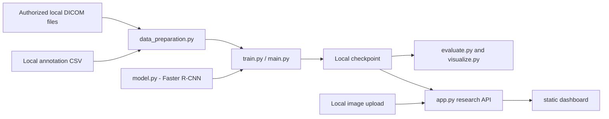
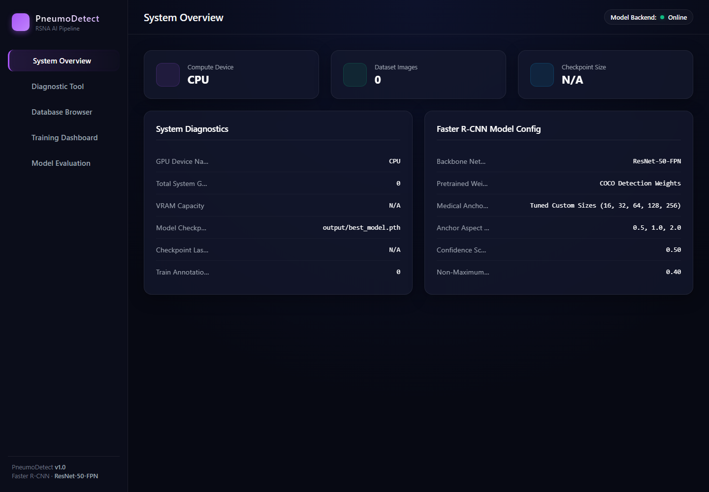
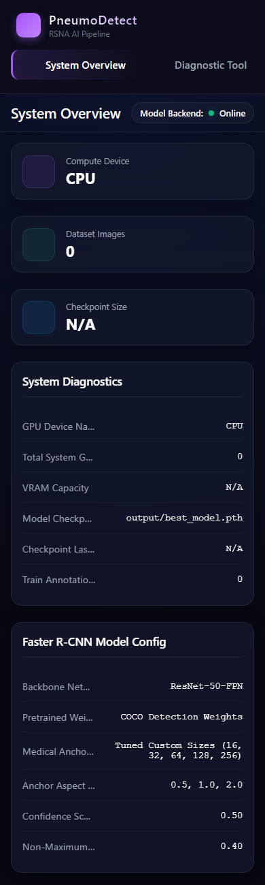

# RSNA pneumonia-region detection experiment

An educational object-detection project for the RSNA Pneumonia Detection Challenge. It contains DICOM/CSV preprocessing, torchvision Faster R-CNN model factories, training, evaluation, visualization and a FastAPI research dashboard.

This is an experimental research application. It has no established clinical validity and must not be used to diagnose, triage or guide treatment. A generic COCO initialization with a newly replaced classification head is not a trained pneumonia detector.

## Source pipeline



This diagram contains no patient images and does not imply a successfully trained model.

## Components and limitations

- `data_preparation.py` groups boxes by patient, rescales images/targets and builds train/validation loaders. Missing DICOM files currently become blank images; verify data completeness before any experiment.
- `model.py` builds ResNet50-FPN Faster R-CNN and replaces the prediction head for two classes. The optional custom-anchor path currently defines one feature-level anchor configuration for an FPN model and needs runtime validation before use.
- `train.py` provides training/validation loops, optimizer/scheduler choices and checkpoint handling. AMP and GPU features depend on a compatible PyTorch/CUDA stack.
- `evaluate.py` implements IoU, matching and an 11-point interpolated AP calculation. Do not assume it reproduces the challenge's official scoring protocol.
- `app.py` serves upload inference, dataset browsing, diagnostics, background training and metrics. It is a local research interface with no authentication. Treat uploads, checkpoint files and returned DICOM metadata as sensitive.

Previous benchmark comparisons, speed/memory percentages and production/clinical claims were not reproduced and have been removed. Existing `output/` metrics and `docs/` plots have not been traced to a reproducible run or dataset split. They are historical artifacts, not audited performance evidence. Patient-containing figures are not embedded or republished here. No new license grant is made by this README.

## Setup

Use a fresh Python environment and a compatible torch/torchvision pair. Review `requirements.txt` before installing:

```sh
python -m pip install -r requirements.txt
```

Obtain the challenge dataset yourself under its applicable terms; this repository does not redistribute it. `config.py` expects `stage_2_train_images/`, `stage_2_test_images/`, `stage_2_train_labels.csv` and `stage_2_detailed_class_info.csv` relative to the working directory. Keep dataset files and trained checkpoints outside version control.

The CLI entry point is `main.py --mode train|evaluate|compare|visualize`; run `python main.py --help` after dependencies are installed. Training can be expensive and pretrained initialization can download weights. `--no_pretrained` avoids requesting pretrained detector/backbone weights. Evaluation expects a compatible trusted checkpoint via `--checkpoint`.

For a local research dashboard:

```sh
python -m uvicorn app:app --host 127.0.0.1 --port 5000
```

Start from the repository root so `static/` resolves. Inference requires `config.MODEL_SAVE_PATH` (`output/best_model.pth`). Missing checkpoints now fail explicitly instead of producing predictions from a newly initialized head. Only load checkpoints you trust. Do not expose training/upload endpoints to a shared network.

## Offline checks — 2026-11-09

```sh
python -m unittest discover -s tests -v
python -m compileall -q app.py model.py train.py main.py evaluate.py data_preparation.py augmentation.py visualize.py config.py
```

Two loader/factory regressions pass after being observed failing before repair. They execute the real function bodies with dependency fakes to verify that missing checkpoints never construct a model and that `pretrained=False` explicitly disables backbone downloads. Syntax compilation passes for the listed modules. These checks establish neither detector accuracy nor a working inference/training run.

The FastAPI server started on loopback with an isolated `pydicom 3.0.2` install. `/api/health` returned 200; diagnostics reported CPU, zero dataset images/annotations and no checkpoint. Browser checks confirmed CPU diagnostics and the empty case list. The browser exposed three malformed `setHTML` calls that prevented all dashboard JavaScript from parsing; these were repaired, and `node --check static/js/app.js` now passes. A narrow-screen sidebar overflow was reproduced and repaired; at 390px the browser confirms no horizontal document overflow.





These are actual local UI captures, with external CDN requests blocked and no patient content. Font icons are consequently absent and the Chart.js-dependent training chart is unavailable (`Chart is not defined` in the blocked-CDN run). The frontend still labels backend health as “Model Backend: Online”; this means the web service responded, not that a checkpoint is loaded. Model-configuration labels are static UI text. No authorized dataset/checkpoint was loaded, and no inference, training, weights download or GPU benchmark was run. Runtime detector correctness remains unverified.
